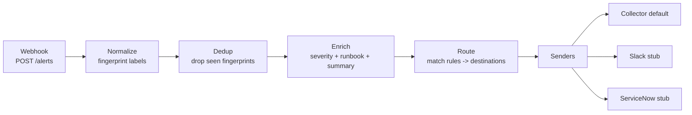

# alert-router

A small webhook service that ingests Alertmanager-style monitoring alerts,
**normalizes** and **deduplicates** them, **enriches** each one with a severity
and an optional runbook link, then **routes** it to one or more destinations by
rule.

Delivery is pluggable. The default sender is an in-memory collector, so the
whole service runs offline with no outbound calls. Slack and ServiceNow senders
are included as stubs that build the payload and log it; wiring a real endpoint
is a configuration step, not a code change.

## Why

Monitoring stacks tend to fire the same alert from multiple sources, with labels
in inconsistent order, and no consistent story about *where* an alert should go
or *what to do* about it. `alert-router` sits between your alert source and your
notification channels and gives you one place to:

- collapse duplicate alerts to a stable fingerprint,
- attach a severity and a runbook link so responders aren't starting from zero,
- decide routing with simple, readable rules instead of scattered integrations.

## Pipeline



The pure transformation steps (`fingerprint`, `dedup`, `enrich`, `route`) live
in `alertrouter/pipeline.py` and are fully unit tested with no network. The
impure parts (shared dedup state, sending) live in `alertrouter/service.py` and
`alertrouter/senders.py`.

## Quickstart

```bash
python -m venv .venv
# Windows PowerShell: .venv\Scripts\Activate.ps1
# bash:               source .venv/bin/activate
pip install -r requirements.txt

# Run the API
uvicorn alertrouter.server:app --reload
```

Post the sample webhook:

```bash
curl -X POST http://127.0.0.1:8000/alerts \
  -H "Content-Type: application/json" \
  -d @examples/sample_webhook.json
```

Sample response (the duplicate `HighErrorRate` alert is deduped, so two alerts
come back):

```json
[
  {
    "fingerprint": "a1b2c3d4e5f60718",
    "severity": "critical",
    "summary": "Error rate above 5% for checkout",
    "runbook": "https://runbooks.example.com/high-error-rate",
    "destinations": ["pagerduty", "slack"],
    "alert": {
      "labels": {"alertname": "HighErrorRate", "service": "checkout", "team": "payments", "instance": "checkout-1:9090"},
      "annotations": {"summary": "Error rate above 5% for checkout", "description": "5xx rate has exceeded the SLO for 10 minutes"},
      "status": "firing",
      "starts_at": "2026-09-27T14:03:00Z"
    }
  },
  {
    "fingerprint": "0f9e8d7c6b5a4231",
    "severity": "high",
    "summary": "Root volume projected to fill within 4 hours",
    "runbook": "https://runbooks.example.com/disk-will-fill-soon",
    "destinations": ["slack", "servicenow"],
    "alert": {
      "labels": {"alertname": "DiskWillFillSoon", "team": "infra", "instance": "db-2:9100"},
      "annotations": {"description": "Root volume projected to fill within 4 hours"},
      "status": "firing",
      "starts_at": "2026-09-27T14:05:00Z"
    }
  }
]
```

(The `fingerprint` values above are illustrative.)

## Endpoints

| Method | Path      | Description                                             |
|--------|-----------|---------------------------------------------------------|
| GET    | `/health` | Liveness probe: `{"status": "ok", "version": ...}`.     |
| POST   | `/alerts` | Ingest a `Webhook`, return the routed alerts.           |
| GET    | `/recent` | Last `N` routed alerts (`?limit=`, default 20).         |

Point the service at a config file with the `ALERTROUTER_CONFIG` environment
variable; it falls back to `examples/config.json`.

## Config format

Routing is driven by a JSON file (see `examples/config.json`):

- **`severity_map`** — maps an `alertname` to a severity, with a `default`
  fallback. An explicit `severity` label on the alert always wins.
- **`runbooks`** — maps an `alertname` to a runbook URL, attached to matching
  alerts.
- **`destinations`** — named delivery targets and their (stub) settings.
- **`rules`** — evaluated in order. Each rule has a `match` object (label values
  and/or `severity`) and a list of `destinations`. An empty `match` (or a rule
  named `default`) is the catch-all used when nothing else matches. Destinations
  from all matching rules are merged, de-duplicated, order preserved.

```json
{
  "severity_map": {"default": "warning", "HighErrorRate": "critical"},
  "runbooks": {"HighErrorRate": "https://runbooks.example.com/high-error-rate"},
  "destinations": {"slack": {"type": "slack", "webhook_url": null}},
  "rules": [
    {"name": "page-on-critical", "match": {"severity": "critical"}, "destinations": ["pagerduty", "slack"]},
    {"name": "default", "match": {}, "destinations": ["slack"]}
  ]
}
```

## Senders

`CollectorSender` (default) records routed alerts in memory and backs `/recent`.
`SlackSender` and `ServiceNowSender` are **stubs**: they build the message /
incident payload they *would* send and log it. To go live, set the endpoint
(`webhook_url` / `instance_url`) in config and replace the log call with a real
HTTP POST. Nothing leaves the host until you do.

## Testing

```bash
pip install pytest httpx
pytest -q
```

`tests/test_pipeline.py` covers the pure functions (fingerprint stability,
dedup, enrichment, routing). `tests/test_api.py` drives the app through FastAPI's
`TestClient` — no real network.

## Project structure

```
alert-router/
├── alertrouter/
│   ├── __init__.py      version + package docstring
│   ├── models.py        pydantic models (Alert, Webhook, RoutedAlert)
│   ├── pipeline.py      pure: fingerprint, dedup, enrich, route
│   ├── senders.py       Sender protocol, CollectorSender, Slack/ServiceNow stubs
│   ├── config.py        load_config -> RouterConfig
│   ├── service.py       Router: full pipeline + dispatch
│   └── server.py        FastAPI app (/health, /alerts, /recent)
├── examples/
│   ├── config.json
│   └── sample_webhook.json
├── tests/
│   ├── test_pipeline.py
│   └── test_api.py
├── Dockerfile
├── pyproject.toml
├── requirements.txt
└── LICENSE
```

## Docker

```bash
docker build -t alert-router .
docker run -p 8000:8000 alert-router
```

Runs as a non-root user and ships a `/health` HEALTHCHECK.

## License

MIT — see [LICENSE](LICENSE).
